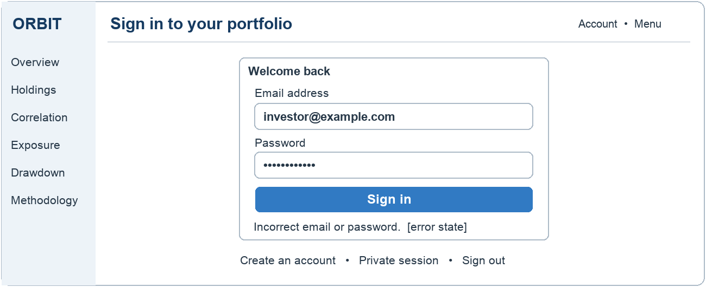
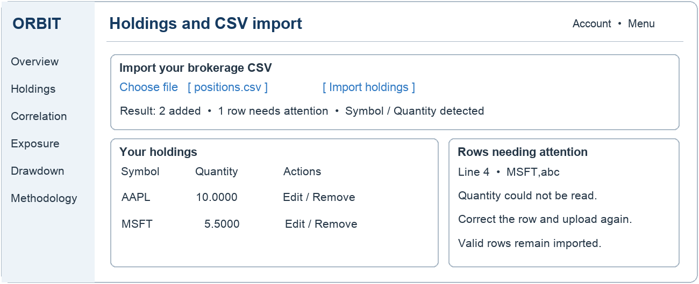
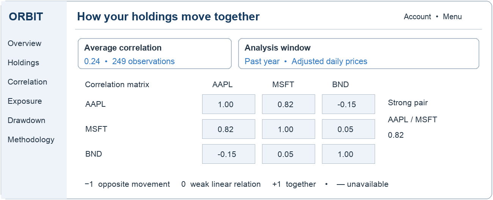
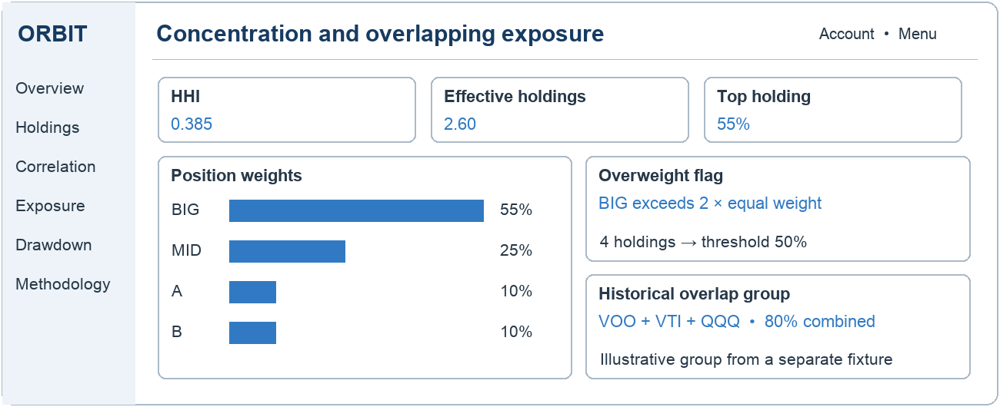
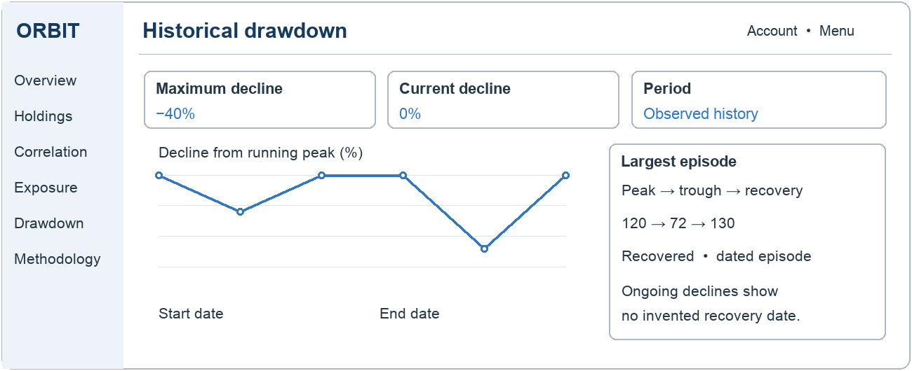
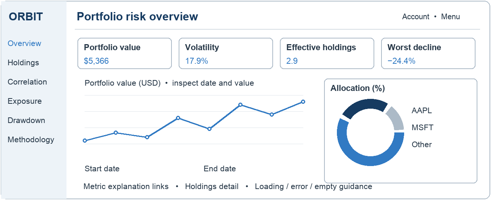
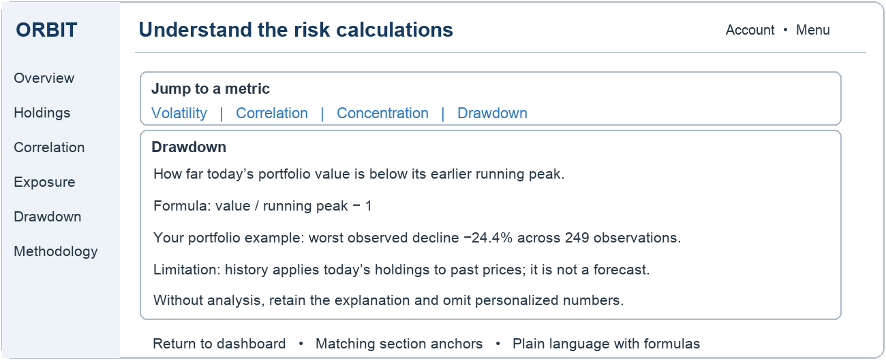

# Sprint 2 preliminary wireframes

**Date:** October 9, 2026. **Owner:** Andrew Lam. These diagrams use illustrative fixture values, not current customer data. They document design, not passed UAT. All seven selected requirements are covered.

Shared rules: labeled controls, visible keyboard focus, exact chart values, non-color indicators, explicit empty/error/loading states, consistent navigation and stacked narrow-screen layouts. Desktop and narrow-screen acceptance remain unexecuted.

## WF-13 Authentication

FR-15 / AC1–AC2. Labeled credentials, masked password and nearby rejection text protect the entry workflow. The shell provides account and sign-out controls.

Trace: [US-13](https://github.com/lam-andrew/portfolio-risk-intelligence/issues/13); W7-13-01–05; W6-UAT-13-01–02.

## WF-2 CSV portfolio import

FR-2/FR-3 / AC1–AC2. Upload status, column detection, row numbers and actionable errors distinguish partial success from total failure. Successfully imported holdings remain visible.

Trace: [US-2](https://github.com/lam-andrew/portfolio-risk-intelligence/issues/2); W7-2-01–05; W6-UAT-2-01–02.

## WF-6 Correlation among holdings

FR-8 / AC1. Numeric labels, observation count, date window and unavailable states make the matrix interpretable without color alone.

Trace: [US-6](https://github.com/lam-andrew/portfolio-risk-intelligence/issues/6); W7-6-01–05; W6-UAT-6-01–02.

## WF-7 Concentration and overlapping exposure

FR-9 / AC1. Weight bars, threshold and historical overlap group explain concentration. The group panel intentionally uses a separate fixture from the four-position allocation; it does not claim constituent look-through.

Trace: [US-7](https://github.com/lam-andrew/portfolio-risk-intelligence/issues/7); W7-7-01–05; W6-UAT-7-01–02.

## WF-8 Historical drawdown

FR-10 / AC1. Headline declines, historical curve and dated peak/trough/recovery details distinguish completed from ongoing episodes.

Trace: [US-8](https://github.com/lam-andrew/portfolio-risk-intelligence/issues/8); W7-8-01–05; W6-UAT-8-01–02.

## WF-10 Risk dashboard

FR-12 / AC1. Metrics lead to point-marked history, allocation and detail. Exact values and chart controls support keyboard access. Loading, error and empty states remain explicit.

Trace: [US-10](https://github.com/lam-andrew/portfolio-risk-intelligence/issues/10); W7-10-01–05; W6-UAT-10-01–02.

## WF-19 Risk methodology companion

FR-12 support / AC1–AC4. Metric anchors connect plain language, formulas, personal examples and limitations; no personalized figures appear without an analysis.

Trace: [US-19](https://github.com/lam-andrew/portfolio-risk-intelligence/issues/62); W7-19-01–05; W6-UAT-19-01–02.
