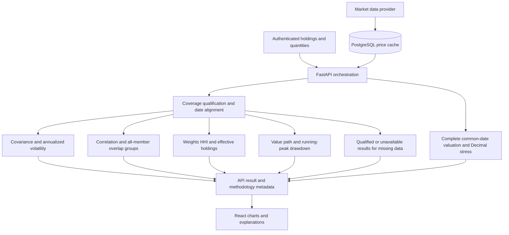

# Risk and Exposure engine significant algorithmic component

Status: proposed specification for instructor review; consolidates existing implementation and accepted ADRs. Updated October 20, 2026. No new financial methodology or contract is adopted by this document.

## 1 Product overview and proposed component

Orbit is a portfolio risk intelligence application for self-directed investors holding stocks and ETFs. Users enter or import holdings, inspect their risk and consult primary SEC filings for context. It measures and explains risk; it does not forecast prices, execute trades or recommend investments.

I propose completing and validating the integrated Risk and Exposure engine as Orbit’s SAC. It transforms dated prices and quantities into covariance-based portfolio volatility, correlation, concentration and overlap groups, historical drawdown, and scenario losses. A holdings table alone cannot show when several positions behave alike or how their combined weight changes portfolio risk.

The engine is already substantially implemented from earlier sprints. This proposal consolidates its algorithm and defines the remaining validation and integration work. Instructor feedback is pending. Sprint 3 will resolve verified gaps and complete acceptance; it will not relabel prior implementation as new work.

## 2 Flow of operations

The API owns authorization, data retrieval and coverage handling. Pure calculation modules return values to the API. The browser presents those values with dates and limitations. SEC research and LLM generation are separate and are not required to calculate core risk.

## 3 Algorithm and analytical behavior

Inputs are ticker symbols, positive share quantities, a requested historical window and provider-adjusted closing prices. The default risk window is 365 calendar days. Historical statistics use common price dates among priced holdings, then simple returns r(i,t) = P(i,t) / P(i,t−1) − 1. Weights are proportional to quantity × latest available adjusted price for each priced holding. Coverage and timing assumptions must accompany interpretation.

| Stage | Logic and output |
| --- | --- |
| Covariance and volatility | Compute sample covariance Σ from aligned returns (T − 1 denominator). Annualized portfolio volatility is √(252 × wᵀΣw). Compare it with Σᵢ wᵢσᵢ, the weighted annualized standalone volatility, to show the diversification difference. Require at least 20 returns. |
| Correlation | Compute Pearson correlation from covariance and each series’ standard deviation. Return the symmetric matrix and ranked distinct pairs. A zero-variance pair is undefined, not zero correlation. |
| Concentration | Compute HHI = Σᵢ wᵢ² and effective holdings = 1 / HHI. Rank top weights. A position above twice the equal-weight share is flagged descriptively; the threshold is not investment advice. |
| Overlap grouping | Seed groups in descending position weight. Add an unassigned candidate only if its correlation is at least 0.75 with every member already present. Report groups of two or more, combined weight and minimum internal correlation; rank by combined weight. |
| Drawdown | Reconstruct V(t) = Σᵢ qᵢP(i,t) using today’s quantities. Track running peak M(t); drawdown = V(t)/M(t) − 1. Identify peak, trough and recovery; retain ongoing episodes. Show up to five deepest episodes meeting the 2% depth filter. |
| Stress scenarios | For a common valid price date within 30 calendar days, apply uniform 10%, 20% or 35% declines. Round each baseline and loss half-up to cents, then sum rows. Withhold totals if any holding lacks a valid common-date price. |

The grouping rule prevents a chain of correlated pairs from being presented as one tightly related group. It is a deterministic greedy heuristic for a fixed input order, not an optimal clustering algorithm; weight ties and the 0.75 threshold can affect grouping. It measures return co-movement, not underlying ETF constituent overlap.

For example, four equal positions have HHI 0.25 and four effective holdings. If three form a qualifying group, their combined exposure is 75% despite the even position sizes. A separate $1,500 portfolio under the 20% scenario loses $300 and retains $1,200. The stress result has no event probability or forecast horizon.

## 4 Rationale implementation and validation

What: an integrated analytical pipeline that explains both position size and shared movement. Why: covariance captures diversification that a weighted average of volatilities misses; overlap grouping makes the correlation matrix interpretable; drawdown adds the depth and duration of historical declines. These capabilities are central to Orbit’s purpose and go beyond CRUD or a static dashboard.

How: retain Python/NumPy pure functions behind authenticated FastAPI routes, with PostgreSQL caching and a React interface. Use Decimal for monetary calculations and floating point for statistics. Docker Compose preserves portability to a separate Proxmox VM. The SAC requires no GPU, LLM subscription or new database service. Covariance costs roughly O(Tn²) for T returns and n holdings; the correlation matrix uses O(n²) space, so practical portfolio-size testing remains necessary.

### Implementation strategy

Week 9: submit this specification, map it to FR-7–FR-12 and US-5–US-10/US-19, and record the starting tests. Week 10: review instructor feedback, complete core PR review, verify data/coverage assumptions and fix demonstrated defects. Week 11: execute normal-stack stress acceptance, repeat dashboard/methodology UAT and record current coverage and performance. Andrew Lam owns these tasks; substantive methodology changes require a reviewed ADR.

### Dependencies risks and acceptance

Adjusted-price availability, date alignment and current quantities shape every result. Existing historical APIs can analyze the priced subset, while stress testing requires complete pricing; these outputs must not imply equivalent coverage. Missing trading dates may lengthen return intervals, latest prices can be stale or differ in date, and current-quantity history is not realized account performance. Audit these cases before final acceptance. Historical covariance and √252 annualization are estimates, not guarantees of future risk.

Validation combines independent numerical comparisons, boundary/property tests, authenticated API checks and browser/API comparisons. The October 20 targeted run passed 99 existing tests across the five risk files at e123023. Final acceptance still requires the integrated-build checks, ST-09 with real market data, truthful unavailable states, and measured performance on the target host. No benchmark or homelab deployment pass is claimed.

Retain regression cases for insufficient history, constant series, missing prices, half-up rounding, non-clique overlap chains, recovered/ongoing drawdowns and cross-user access. Record warm-cache timing at increasing portfolio sizes and verify the NFR-4 cache-reuse requirement before deployment; report hardware, dataset size and upstream-call counts. Secondary Q&A quality is evaluated separately and cannot block core calculations.

### Design and implementation references

[Risk methodology ADR 0012](https://github.com/lam-andrew/portfolio-risk-intelligence/blob/e123023d48daa67516f1e31e5d8e12d80eb510f8/docs/adr/0012-risk-methodology.md) · [Stress ADR 0018](https://github.com/lam-andrew/portfolio-risk-intelligence/blob/e123023d48daa67516f1e31e5d8e12d80eb510f8/docs/adr/0018-hypothetical-portfolio-stress-tests.md) · [Risk engine source](https://github.com/lam-andrew/portfolio-risk-intelligence/tree/e123023d48daa67516f1e31e5d8e12d80eb510f8/backend/app/engines/risk) · [SAC living specification](https://github.com/lam-andrew/portfolio-risk-intelligence/blob/codex/sprint3-planning/docs/sac-specification.md)
