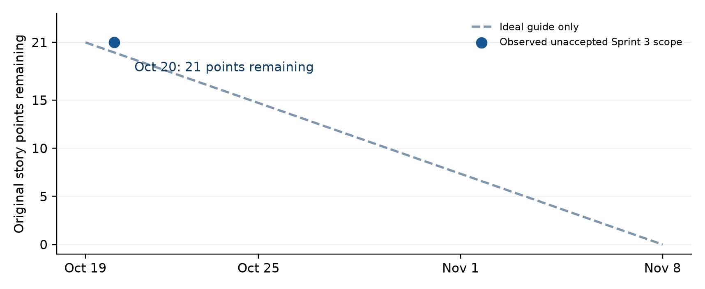

# Sprint 3 completion plan

Updated October 20, 2026. Owner: Andrew Lam. Reviewable plan; no issue closure or sprint reassignment.

## 2 Groomed backlog and carryover

| Selected Sprint 3 story | Priority and estimate | Why this order and what remains |
| --- | --- | --- |
| US-9 / FR-11; Stress testing | Must · 8 points; First | Completes the core risk workflow. Finish ST-09 live-provider acceptance and verify chart explanations, rounding and complete pricing. |
| US-11 / FR-13; SEC ingestion | Should · 5 points; Second | Supplies trustworthy source text for Q&A. Verify source passages and restart/resumption before relying on downstream answers. |
| US-12 / FR-14; Grounded questions | Should · 8 points; Third, capacity-gated | Depends on indexed filings and available generation. Review filing scope and local embeddings, then run the 20-case live evaluation. |

Sprint 3 retains its original 21 points (8 + 5 + 8). All three stories are In Progress. Early implementation reduces coding work but does not remove testing, review or integration risk. The eight-point Q&A story is the largest uncertainty and must not displace core completion.

### Sprint 2 completion work carried forward

| Story | Original points | Remaining completion focus |
| --- | --- | --- |
| US-13 authentication | 3 | Review session and ownership evidence on the selected release revision. |
| US-2 CSV import | 3 | Review PR #103; repeat import and error handling in the final build. |
| US-6 correlation | 5 | Review PR #102; final matrix/API comparison at varied portfolio sizes. |
| US-7 concentration | 3 | Verify HHI, overlap grouping and honest interpretation after integration. |
| US-8 drawdown | 2 | Confirm recovered, ongoing and unavailable states in the release UI. |
| US-10 dashboard | 5 | Review Atlas changes; verify full, partial, empty and failure states. |
| US-19 methodology / #62 | 2 | Check formulas, personal examples and metric-to-explanation links. |

These seven stories total 23 original points and remain assigned to Sprint 2. Fourteen browser procedures passed October 10, but shared review, final-build acceptance and integration gates remain open. This is carryover completion work, not a new 23-point implementation commitment or a second award of points. There is no remaining Sprint 1 acceptance procedure carried into Sprint 3: the five earlier procedures were executed October 10.

## 3 Definition of Done and completion tasks

The following Definition of Done applies to every selected and carryover story. Andrew Lam owns implementation, test execution, documentation and the final acceptance decision. Instructor feedback informs the SAC specification; it does not substitute for product testing.

Requirement and acceptance criteria are current, linked to an issue, and mapped to specific UAT, unit and system tests.

UI and workflow states match the implemented design, including loading, empty, unavailable, failure and recovery. Calculations remain in the backend.

Applicable code, persistence and integration work is complete. Automated tests pass at the reviewed revision and actual results identify date, environment and limitations.

Required UAT is executed on the selected integrated build; expected and actual outcomes are recorded. An older branch pass alone is insufficient.

The PR diff is reviewed and required CI/security checks pass before GitHub merge. The issue links implementation, test evidence and relevant design records.

User documentation, requirements, architecture and test traceability match the release. No blocking acceptance defect remains, and the acceptance decision is recorded before Done.

### Story-specific completion work

| Scope | Required tasks beyond the shared checklist |
| --- | --- |
| US-9 | Verify scenario selection, dated complete valuation, cent reconciliation, changed holdings and failure states; run ST-09; preserve ADR 0018 limitations. No new database schema is needed. |
| US-11 | Compare extracted text to the SEC source; test worker interruption/resumption, duplicates and unsupported tickers; verify owner access, progress and persisted corpus. |
| US-12 | Review server-enforced filing scope, bounded follow-ups, citation navigation and mobile chat; evaluate retrieval/support/abstention, provider errors and configuration. Review embedding migration separately. |
| Seven carryover stories | Run the carryover checks in [Sprint 3 tests](sprint3-tests.md) on the final integrated build, retain existing detailed specifications, review related PRs and resolve final acceptance without changing historical sprint dates. |

### Technical work remains technical

The Proxmox VM, container deployment, backup/restore, reverse proxy and operational checks are technical tasks. They are tracked against portability, security and reliability requirements, not presented as functional user stories or awarded new story points here. The existing local Compose setup does not prove homelab deployment.

## 4 Weekly action plan and retrospective improvements

| Week | Goal and exit evidence | Owner and dependency |
| --- | --- | --- |
| 9 · Oct 19–25 | Submit SAC specification and planning report; preserve estimates; establish current test baseline; prepare the review and final-UAT checklist. | Andrew · existing code, board and Sprint 2 retrospective |
| 10 · Oct 26–Nov 1 | Apply instructor feedback to the SAC; fix only demonstrated core defects; review/integrate the core stack; execute stress ST-09 and repeat carryover UAT. Begin SEC source/restart checks. | Andrew · instructor feedback, reviewed code, provider access |
| 11 · Nov 2–8 | Finish core acceptance and Sprint 3 test/coverage report. Complete US-11 checks. Attempt the bounded US-12 evaluation only after its prerequisites pass. Decide any explicit secondary rollover. | Andrew · accepted core, indexed filings and available generation |
| 12 · Nov 9–15 | Address agreed rollover defects; resume the separate Proxmox VM deployment, verify health, persistent storage and backups. Keep the local demo available if host access is blocked. | Andrew · network/VM access and reviewed deployable release |
| 13 · Nov 16–22 | Run release regression, accessibility/error-state review and restore verification; finish end-user guide and as-built architecture. | Andrew · stable deployed candidate or documented local fallback |
| 14 · Nov 23–29 | Resolve release blockers, complete final testing/requirements documentation and rehearse the final demonstration. Freeze feature scope. | Andrew · final acceptance and verified submission access |

These are goals and exit checks, not claims that future work has occurred. Q&A is reduced or deferred if its provider or quality gate remains blocked at the Week 10 review. A change to committed scope or estimates must be recorded in the issue and board before the next report; no silent reassignment is made here.

### Applying the Sprint 2 retrospective

Sprint 2 produced useful functionality and repeatable fixtures, but implementation outpaced integration and acceptance. Several defects came from misleading UI explanations rather than the underlying arithmetic. The long PR stack also increased the cost of review.

For Sprint 3 I will finish one core acceptance/review item before starting another feature, attach evidence to the story as each check is completed, and test user-facing interpretation alongside the numerical result. I will review the integration queue each week and keep secondary model work behind the core gate. These changes target the actual delivery bottleneck instead of treating more commits as higher velocity.

## 6 Burndown and delivery analysis

Figure 1. Sprint 3 original story points remaining. The only measured point is October 20: US-9, US-11 and US-12 are all still open/In Progress, leaving 21 points. The dashed line is an ideal planning guide, not observed progress or a forecast. Future actual points are deliberately absent.

| Measure | Value | Meaning |
| --- | --- | --- |
| Sprint 3 baseline | 21 points | US-9 8 + US-11 5 + US-12 8 |
| Accepted Sprint 3 points | 0 | No selected story has passed every completion gate. |
| Sprint 2 carryover | 7 stories / 23 original points | Separate completion backlog, not added to the Sprint 3 chart. |
| Fresh Week 9 risk regression | 99 passed | Verification throughput, not story-point velocity. |
| Week 9 feature implementation | None claimed | Planning, specification and verification are the current contribution. |

The combined open inventory is substantial, but its original estimates are not a fresh estimate of remaining effort. Much of the code exists. Remaining work is concentrated in reviews, branch integration, normal-stack tests and final acceptance. I will report those completed activities alongside accepted points rather than infer delivery from commit volume.

A practical Sprint 3 success condition is an accepted core risk workflow and a deployable, reviewed release candidate. Secondary filing and Q&A acceptance follows only when its dependencies and quality gates pass. The weekly review will identify any unfinished scope explicitly instead of drawing an artificial downward line.

## Grooming record

No functional story added, removed, split, re-estimated or reassigned. Prioritize core review, integration and acceptance before secondary live evaluation. US-21 remains outside the selected sprint, and stretch items remain deferred. Current board snapshot: ten In Progress (seven Sprint 2 and three Sprint 3), six Done, three Backlog. Existing Sprint fields are retained to preserve origin; carryover completion is explicit above.

[Algorithm specification](sac-specification.md) · [Test specifications](sprint3-tests.md)

## PR integration checkpoint — October 20, 2026

Maintenance #105, frontend dependency updates #97 and Sprint 2 documentation #95
are merged to main after review and passing checks. The incompatible standalone
Node type upgrade #88 is closed; coordinated tooling/runtime work remains #85.
The production redirect dependency audit finding is repaired by #105.

The Atlas/research/demo/planning stack is consolidated through #94 into the
remaining draft Q&A review #92. Parent-branch merges are not a main release or
a story acceptance. The review fixed a desktop/mobile theme synchronization bug
and reconciled local embeddings with filing-scoped readiness and retrieval.
Combined verification: 380 backend and 122 frontend passes, plus eight native
PostgreSQL passes and migration rollback/re-upgrade. Nine ordinary-suite skips
comprise those eight native cases and the opt-in real-encoder check. See
[the integration evidence](us12-question-tests.md#atlaslocal-retrieval-integration--october-20-2026).

Before main integration, complete the labeled live-model evaluation and owner
acceptance required by #92. OptiPlex performance, separate-VM deployment and
backups remain unverified technical work. Story assignments, estimates and board
completion status are unchanged; implementation and green automated tests do not
close these acceptance gates.
